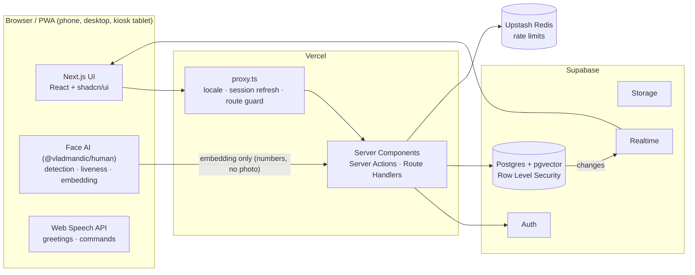
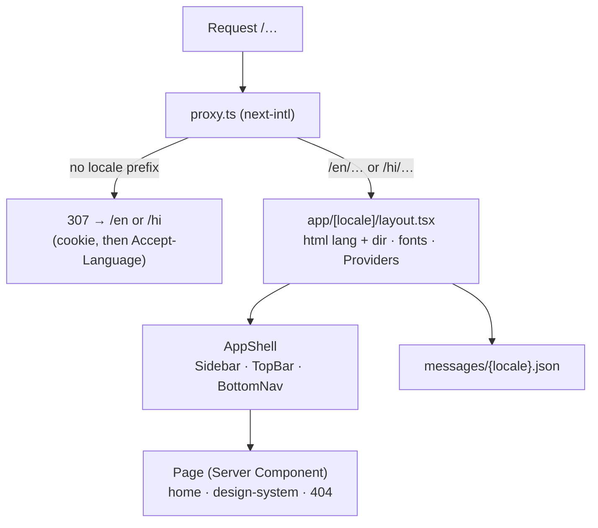
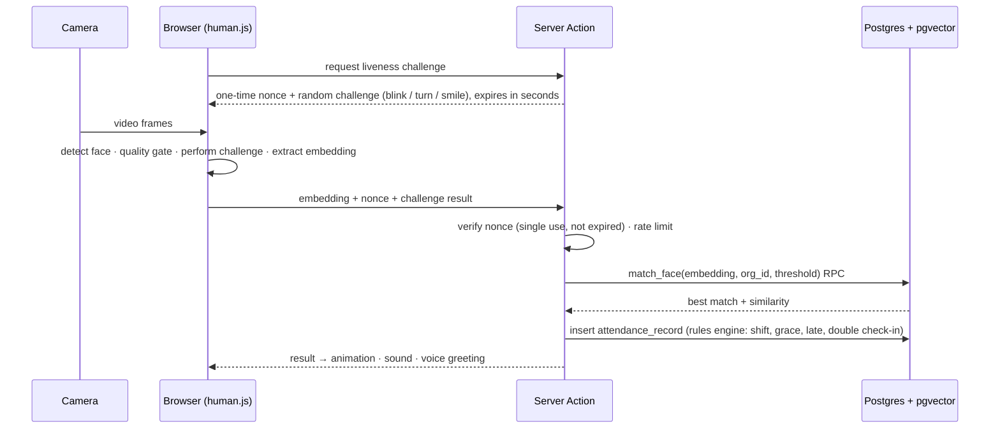

# Architecture

> **Status:** Phase 0 is built. Diagrams marked **(planned)** describe the target design from
> `CLAUDE.md` and become "built" as each phase lands.

## 1. System overview (planned)



**Key constraint:** face detection, liveness and embedding extraction run **in the browser**
(serverless functions cannot run heavy ML, and on-device processing keeps raw face images private).
Only the numeric embedding goes to the server. Matching, attendance writes and every authorization
decision happen **server-side**, with Postgres Row Level Security as the final authority. The client
is never trusted.

## 2. What exists after Phase 0



| Concern            | Where                                       | Notes                                                     |
| ------------------ | ------------------------------------------- | --------------------------------------------------------- |
| Locale negotiation | `proxy.ts`, `i18n/routing.ts`               | Every URL carries its locale (`localePrefix: 'always'`)   |
| Translations       | `messages/*.json`, `i18n/request.ts`        | Keys are type-checked (`i18n/global.d.ts`)                |
| Text direction     | `i18n/locales.ts` → `<html dir>`            | Radix `Direction.Provider` mirrors menus for RTL          |
| Theme              | `next-themes` in `components/providers.tsx` | `class="dark"` set before paint, so no flash              |
| Design tokens      | `app/globals.css`                           | Semantic OKLCH variables; components never use raw colors |
| Motion             | `lib/motion.ts`, `components/motion.tsx`    | Shared presets; `reducedMotion="user"`                    |
| Shell              | `components/shell/*`                        | Sidebar ≥ md, bottom bar < md, logical CSS properties     |

### Folder layout

```
app/[locale]/          pages and the root layout (one per locale)
components/ui/         shadcn/ui primitives (generated, then owned by us)
components/shell/      app shell: sidebar, bottom nav, top bar controls
components/            shared building blocks (EmptyState, DataTable, motion, providers)
features/<feature>/    feature-specific components and logic
i18n/                  locale config, routing, request config, navigation helpers
lib/                   framework-free utilities (cn, motion presets)
messages/              translation files (en, hi)
supabase/migrations/   SQL migrations (from Phase 1)
scripts/               repository scripts (docs:check)
tests/unit/            Vitest + Testing Library
tests/e2e/             Playwright (desktop + mobile projects)
```

## 3. Face pipeline (planned, Phases 2–3)



## 4. Auth flow (planned, Phase 1)

```mermaid
sequenceDiagram
  participant U as User
  participant P as proxy.ts
  participant SA as Server Action
  participant SB as Supabase Auth
  participant DB as Postgres (RLS)
  U->>SA: email + password (rate limited via Upstash)
  SA->>SB: signInWithPassword
  SB-->>SA: session (httpOnly cookies via @supabase/ssr)
  SA-->>U: redirect by role (admin → /admin, member → /dashboard)
  U->>P: later requests
  P->>SB: refresh session if expired
  P-->>U: allow, or redirect to login
  Note over DB: every query runs as the user; RLS policies scope rows to their org_id and role
```
