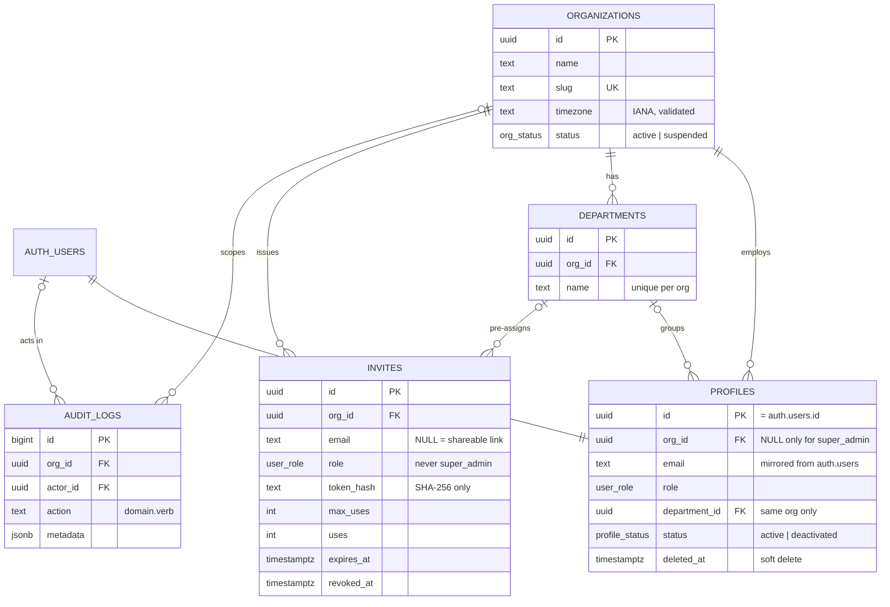
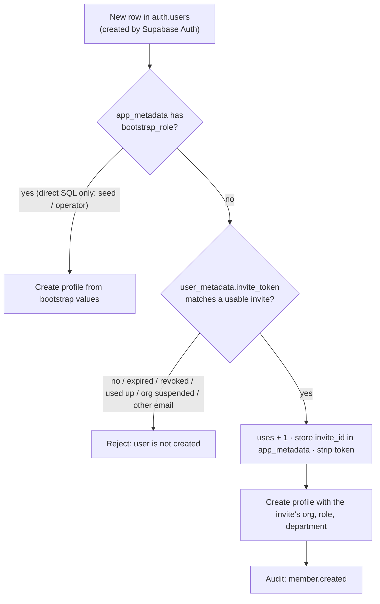

# Database

Postgres 17 on Supabase. All schema changes are SQL migrations in `supabase/migrations/`; local demo
data is in `supabase/seed.sql`.

| Migration                                 | Phase | What it does                                                                                         |
| ----------------------------------------- | ----- | ---------------------------------------------------------------------------------------------------- |
| `20261016000100_identity_and_tenancy.sql` | 1a    | Organizations, departments, profiles, invites, audit logs, RLS, admin functions, invite-only sign-up |

## Entity relationships

## Tables

### `organizations`

| Column                     | Type         | Notes                                                                  |
| -------------------------- | ------------ | ---------------------------------------------------------------------- |
| `id`                       | uuid         | PK                                                                     |
| `name`                     | text         | 2–120 characters                                                       |
| `slug`                     | text         | Unique; lower-case letters, digits, single hyphens; 3–40               |
| `timezone`                 | text         | IANA name (trigger checks `pg_timezone_names`); default `Asia/Kolkata` |
| `status`                   | `org_status` | `active` / `suspended`. Suspended orgs lose all tenant access          |
| `created_at`, `updated_at` | timestamptz  | `updated_at` maintained by trigger                                     |

### `departments`

`id`, `org_id` → organizations, `name` (2–100, unique per org), timestamps. `unique (org_id, id)`
lets other tables reference a department **of the same organization only**.

### `profiles`

One row per login, created by a trigger on `auth.users` (clients cannot insert).

| Column                                                                         | Notes                                                                                                       |
| ------------------------------------------------------------------------------ | ----------------------------------------------------------------------------------------------------------- |
| `id`                                                                           | PK, = `auth.users.id` (cascade delete)                                                                      |
| `org_id`                                                                       | NULL only for `super_admin` (`CHECK`)                                                                       |
| `email`                                                                        | Lower-case copy of `auth.users.email`, kept in sync by trigger                                              |
| `role`                                                                         | `super_admin`, `org_admin`, `manager`, `member`                                                             |
| `full_name`, `avatar_url`, `preferred_language`, `theme`, `notification_prefs` | Personal settings; the **only** columns a user may update                                                   |
| `department_id`                                                                | Composite FK `(org_id, department_id)`, so it must be in the same org; cleared if the department is deleted |
| `status`                                                                       | `active` / `deactivated`                                                                                    |
| `deleted_at`                                                                   | Soft delete (history kept; personal data purged by the Phase 11 retention job)                              |

### `invites`

| Column                                    | Notes                                                                                           |
| ----------------------------------------- | ----------------------------------------------------------------------------------------------- |
| `email`                                   | Set for email invites (single use, bound to that address); NULL for shareable link/code invites |
| `role`                                    | Any role except `super_admin` (`CHECK`)                                                         |
| `department_id`                           | Optional pre-assignment (same-org composite FK)                                                 |
| `token_hash`                              | SHA-256 hex of the token/code. **The plaintext is never stored.**                               |
| `max_uses`, `uses`                        | `uses ≤ max_uses`; email invites must have `max_uses = 1`                                       |
| `expires_at`, `revoked_at`, `accepted_at` | Lifecycle                                                                                       |
| `created_by`                              | Defaults to `auth.uid()`; RLS requires it to be the caller                                      |

### `audit_logs`

Append-only: a trigger raises on any `UPDATE` or `DELETE`, **even for the table owner**. `action` is
`domain.verb` (e.g. `member.updated`). `metadata` must never contain passwords, tokens or biometric
data. Written by database functions and by the server (service role); clients have no insert rights.

## Security model

### Helper functions (`private` schema, not exposed through the API)

| Function                     | Returns                                                                                |
| ---------------------------- | -------------------------------------------------------------------------------------- |
| `private.my_org_id()`        | Caller's org, or NULL if the caller is deactivated, deleted, or their org is suspended |
| `private.my_role()`          | Caller's role, or NULL if deactivated or deleted                                       |
| `private.my_department_id()` | Caller's department                                                                    |
| `private.is_super_admin()`   | Whether the caller is the active Super Admin                                           |

They read the caller's **current** profile row, so deactivating someone or changing their role
takes effect on their very next request, even while their access token is still valid (this is
tested).

### Row Level Security policies

| Table           | SELECT                                                                          | INSERT                              | UPDATE                                     | DELETE             |
| --------------- | ------------------------------------------------------------------------------- | ----------------------------------- | ------------------------------------------ | ------------------ |
| `organizations` | Own org; Super Admin: all                                                       | Super Admin                         | Super Admin (`name`, `timezone`, `status`) | —                  |
| `departments`   | Own org (Super Admin: none)                                                     | Org Admin, own org                  | Org Admin, own org (`name`)                | Org Admin, own org |
| `profiles`      | Self; Org Admin: own org; Manager: own department; Super Admin: org admins only | — (trigger)                         | Self, personal columns only                | —                  |
| `invites`       | Org Admin: own org; Super Admin: `org_admin` invites                            | Same, and `created_by = auth.uid()` | Same (`revoked_at` only)                   | —                  |
| `audit_logs`    | Org Admin: own org; Super Admin: platform and organization entries              | —                                   | — (trigger blocks)                         | — (trigger blocks) |

Anonymous (signed-out) clients have **no privileges on any table**; public pages read through the
server.

### Column-level privileges

Supabase grants everything on `public` tables by default. The migration revokes that and grants back
only what each table needs, e.g. users may `UPDATE profiles (full_name, avatar_url,
preferred_language, theme, notification_prefs)`. An attempt to change `role`, `org_id`,
`department_id`, `status` or `email` fails with `42501 permission denied`.

### Admin functions (RPC)

Role, department and status change **only** through these `SECURITY DEFINER` functions. Each checks
permissions and writes its audit row in the same transaction.

| Function                                                                   | Rules                                                                                       |
| -------------------------------------------------------------------------- | ------------------------------------------------------------------------------------------- |
| `admin_update_member(member_id, role?, department_id?, clear_department?)` | Org Admin; same org; never `super_admin`; not your own role; the org keeps ≥ 1 active admin |
| `admin_set_member_status(member_id, status)`                               | Org Admin; same org; not yourself; keeps ≥ 1 active admin                                   |
| `admin_delete_member(member_id)`                                           | Soft delete; same rules                                                                     |

Error codes: `42501` (not allowed), `P0002` (member not found, including other orgs' members),
`P0001` with hint `last_admin`, `23503` (department from another org).

### Invite-only sign-up

- Supabase Auth inserts users with only its default `app_metadata` and adds custom values in a later
  `UPDATE`, so **even the server's secret-key API cannot use the bootstrap path**. Only direct SQL can.
- A second trigger strips `invite_token` whenever user metadata is written, because Supabase Auth
  rewrites the metadata after inserting the user.
- Public sign-up is also disabled in Auth settings (`[auth] enable_signup = false`). The trigger is
  defence in depth.

## Seed data (`supabase/seed.sql`, local only)

Organization **Demo College** (`demo-college`, Asia/Kolkata) with departments Computer Science,
Mechanical Engineering and Administration. Accounts are listed in
[SETUP.md](SETUP.md#demo-accounts-local-only).
